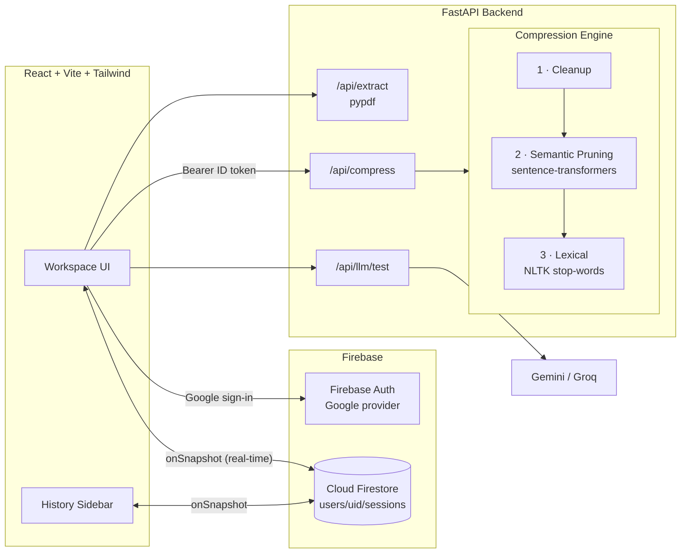

<div align="center">

# ⚡ ContextFlow

### AI Context & Prompt Compression Platform

**Fit massive documents into any LLM context window and cut token costs by 40–80% without losing the facts that matter.**


</div>

---

## 📌 Overview

Large Language Models charge per token and have hard context limits. Pasting a 200-page PDF into a prompt either **crashes** (context overflow) or **wastes money** on irrelevant text.

**ContextFlow** fixes this with a **query-aware 3-stage NLP compression pipeline**. You give it a document and a question, and it returns a much smaller prompt that keeps only the information needed to answer that question. You can measure the token and cost savings and test the result against Gemini or Groq right in the app.

## ✨ Features

| Feature | Description |
|---|---|
| 🔐 **Google Sign-In** | One-click auth via Firebase Authentication |
| ☁️ **Real-time Auto-Sync** | Every session is saved to Cloud Firestore and streamed back via `onSnapshot`, so it syncs instantly across devices and works offline |
| 🗂️ **History Sidebar** | Search, reload, rename, edit and delete past sessions. Edits auto-save as you type (debounced) |
| 📄 **PDF / TXT Upload** | Server-side text extraction with `pypdf` (drag & drop supported) |
| 🧠 **3-Stage Compression** | Cleanup → Semantic Pruning → Lexical Compression with an adaptive token budget |
| 🎚️ **Target Ratio Slider** | Pick 20%–80% token reduction. The engine escalates compression until the target is met |
| 📊 **Metrics Dashboard** | Original vs. compressed tokens, % saved, estimated $ saved (per call and per 1K calls) for 8 popular models |
| 🗺️ **Chunk Relevance Map** | Interactive heat-map of which chunks were kept or pruned and their cosine-similarity scores |
| 🤖 **LLM Playground** | Send the compressed prompt to Gemini or Groq, optionally side-by-side with the original |

## 🏗️ Architecture



### The compression pipeline

| Stage | What it does | Tech |
|---|---|---|
| **1 · Cleanup** | Unicode normalisation, fixes PDF hyphenation and hard line-wraps, strips page numbers, decorative rules, repeated headers/footers and duplicate paragraphs. Code blocks are preserved. | `re`, `unicodedata` |
| **2 · Semantic Pruning** | Splits text into token-bounded chunks (paragraph → sentence → word windows), embeds chunks and the query with `all-MiniLM-L6-v2`, ranks by cosine similarity and greedily keeps the best chunks within a token budget, in original order. With no query, it ranks by similarity to the document centroid (salience). Falls back to TF-IDF if PyTorch is unavailable. | `sentence-transformers`, `numpy` |
| **3 · Lexical Compression** | Tiered (`light` → `medium` → `aggressive`) removal of verbose phrases, hedges, articles and stop-words. **Protects** named entities, acronyms, numbers, technical tokens (`GPT-4`, `file.py`), negations (`not`, `never`) and query keywords. | `nltk` |

**Adaptive budget:** before Stage 2 runs, the engine measures how much Stage 3 will likely remove. It then sizes the semantic budget so the final output lands on the user's target ratio without over-pruning. All counts are exact, using `tiktoken` (`o200k_base`).

## 🧰 Tech Stack

- **Frontend:** React 19, Vite 6, Tailwind CSS 4, Lucide React
- **Auth & DB:** Firebase Authentication (Google), Cloud Firestore with offline persistence and `onSnapshot` listeners
- **Backend:** Python, FastAPI, Uvicorn, Pydantic v2
- **NLP:** tiktoken, pypdf, NLTK, sentence-transformers (PyTorch), NumPy
- **LLMs:** Google Gemini API, Groq API (OpenAI-compatible)
- **Security:** Firestore rules that isolate each user's data, plus optional backend verification of Firebase ID tokens

## 📁 Project Structure

```
contextflow/
├── backend/
│   ├── app/
│   │   ├── main.py              # FastAPI routes
│   │   ├── config.py            # env-driven settings
│   │   ├── auth.py              # Firebase ID-token verification
│   │   ├── extract.py           # PDF / text extraction
│   │   ├── llm.py               # Gemini & Groq clients
│   │   ├── schemas.py           # Pydantic models
│   │   └── compression/
│   │       ├── cleanup.py       # Stage 1
│   │       ├── semantic.py      # Stage 2
│   │       ├── lexical.py       # Stage 3
│   │       ├── pipeline.py      # orchestration + adaptive budget
│   │       └── tokens.py        # tiktoken counting
│   ├── scripts/download_models.py
│   ├── tests/test_pipeline.py
│   ├── requirements.txt
│   └── .env.example
├── frontend/
│   ├── src/
│   │   ├── components/          # Navbar, Sidebar, InputPanel, MetricsCards, ...
│   │   ├── context/             # Auth + Toast providers
│   │   ├── hooks/               # useSessions (onSnapshot), useBackendHealth, ...
│   │   └── lib/                 # firebase, api, sessions (Firestore), pricing
│   ├── package.json
│   └── .env.example
├── firestore.rules
├── firebase.json
└── README.md
```

## 🚀 Getting Started

### Prerequisites
- Node.js 20+ and npm
- Python 3.9+
- A Firebase project (free Spark plan is enough)
- *(Optional)* A [Gemini](https://aistudio.google.com/app/apikey) or [Groq](https://console.groq.com/keys) API key

### 1. Clone
```bash
git clone https://github.com/<your-username>/contextflow.git
cd contextflow
```

### 2. Firebase setup
1. Go to the [Firebase Console](https://console.firebase.google.com/) and create a project.
2. **Authentication → Sign-in method →** enable **Google**.
3. **Firestore Database → Create database** (production mode).
4. **Firestore → Rules:** paste the contents of [`firestore.rules`](firestore.rules) and click Publish.
5. **Project settings → General → Your apps →** add a **Web app** and copy its config.

### 3. Backend
```bash
cd backend
python3 -m venv venv
source venv/bin/activate          # Windows: venv\Scripts\activate
pip install -r requirements.txt
cp .env.example .env              # add FIREBASE_PROJECT_ID and GEMINI/GROQ keys
python scripts/download_models.py # one-time: NLTK, tiktoken, MiniLM (~90 MB)
uvicorn app.main:app --reload --port 8000
```
Interactive API docs: http://localhost:8000/docs

### 4. Frontend
```bash
cd frontend
npm install
cp .env.example .env              # paste your Firebase web config
npm run dev
```
Open http://localhost:5173 and sign in with Google.

### 5. Tests
```bash
cd backend && pip install -r requirements-dev.txt && pytest -q
```

## 🔌 API Reference

| Method | Endpoint | Description |
|---|---|---|
| `GET` | `/api/health` | Status, embedding backend, tokenizer, configured LLM providers |
| `POST` | `/api/tokens` | Exact token count `{ text }` |
| `POST` | `/api/extract` | Multipart file upload → extracted text + token count |
| `POST` | `/api/compress` | `{ text, query, target_ratio, chunk_tokens, enable_semantic, enable_lexical }` |
| `POST` | `/api/llm/test` | `{ provider: "gemini" \| "groq", prompt, query }` |

## 🔒 Security Notes
- API keys live **only** in `backend/.env` and are never sent to the browser.
- Firestore rules allow each user to read and write only `users/{their uid}/sessions`.
- Set `AUTH_REQUIRED=true` in production so the API rejects requests without a valid Firebase ID token.

## 🗺️ Roadmap
- [ ] OCR for scanned PDFs (Tesseract)
- [ ] LLMLingua-2 token-level compression as an optional Stage 4
- [ ] Shareable public links for sessions
- [ ] Docker Compose and one-click deploy (Render + Firebase Hosting)

## 👤 Author
**Your Name** · B.Tech CSE · [LinkedIn](https://linkedin.com/in/your-profile) · [GitHub](https://github.com/your-username)

## 📄 License
MIT
